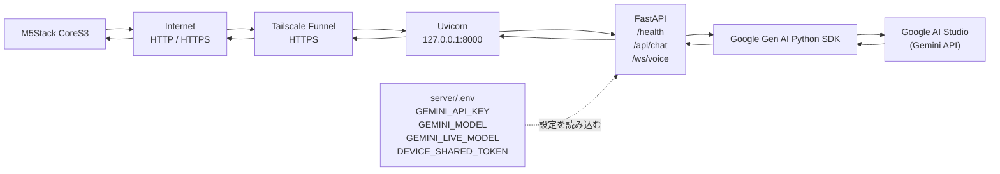

# ai-edge-server

M5Stack CoreS3などの小型デバイスから、DojoPaaS上の軽量なFastAPIサーバーを経由してGoogle Geminiへ接続するサンプルです。

テキストチャットに加えて、Gemini Live APIを使ったPCM音声のリアルタイム会話サンプルを含みます。サーバーは音声認識・音声合成を実行せず、認証、セッション管理、音声ストリームの中継だけを担当します。

## 認証設計

採用したデバイス単位の認証方針は [ADR-0001](docs/adr/0001-device-authentication.md) に記録しています。

ただし、現行のPoC実装はまだ全デバイス共通の`DEVICE_SHARED_TOKEN`方式です。ADRの方式へ移行するまでは、公開運用ではなく検証用途に限定し、HTTPSと共有トークンを必ず使用してください。

## システム構成

```text
M5Stack CoreS3
    ├─ HTTP/HTTPS + JSON ────────────────┐
    └─ WSS + PCM binary ─────────────────┤
                                         ▼
DojoPaaS: FastAPI + Uvicorn
    ├─ /api/chat ─ Google Gen AI SDK ───► Gemini API
    └─ /ws/voice ─ Gemini Live API ◄────► PCM stream
```

`GEMINI_API_KEY`はDojoPaaSにだけ置き、CoreS3には保存しません。

## サーバー構成概要



DojoPaaSでは、外部からの通信をTailscale Funnelで受け、FastAPIを内部の`127.0.0.1:8000`で動かします。Gemini APIキーは`server/.env`からサーバーだけが読み込み、CoreS3へは共有トークンだけを設定します。

## ファイル構成

```text
ai-edge-server/
├── README.md
├── .gitignore
├── tailscale-setup.sh
├── server/
│   ├── main.py
│   ├── voice_gateway.py
│   ├── requirements.txt
│   └── .env.example
└── device/
    └── cores3/
        ├── cores3.ino
        ├── touch_chat/
        │   └── touch_chat.ino
        └── voice_chat/
            └── voice_chat.ino
```

## DojoPaaS側のセットアップ

以下はUbuntu 24.04での例です。`/opt/ai-edge-server`は実際にソースを配置する場所へ読み替えてください。

### 1. 必要なパッケージを入れる

```bash
sudo apt update
sudo apt install -y git python3 python3-venv python3-pip
```

### 2. Gitでプロジェクトを取得して仮想環境を作る

```bash
sudo mkdir -p /opt/ai-edge-server
sudo chown "$USER":"$USER" /opt/ai-edge-server
cd /opt/ai-edge-server
git clone <このリポジトリのURL> .
python3 -m venv .venv
source .venv/bin/activate
python -m pip install --upgrade pip
python -m pip install -r server/requirements.txt
```

### 3. 環境変数を設定する

```bash
cd /opt/ai-edge-server
cp server/.env.example server/.env
nano server/.env
```

最低限、次の値を変更します。

```dotenv
GEMINI_API_KEY=実際のGemini APIキー
GEMINI_MODEL=gemini-3.8-flash
GEMINI_LIVE_MODEL=gemini-3.8-live
DEVICE_SHARED_TOKEN=十分に長いランダムな共有トークン
```

`GEMINI_API_KEY`はサーバー側の環境変数にだけ設定し、GitやCoreS3へコピーしないでください。Google AI Studio側ではGemini API専用の制限を設定し、本番ではDojoPaaSのSecret機能などを使うことを推奨します。

共有トークンを設定すると、`POST /api/chat`は`X-Device-Token`ヘッダーが一致した場合だけ受け付けます。`GET /health`は疎通確認用に公開のままです。`/ws/voice`は`DEVICE_SHARED_TOKEN`が未設定の場合も接続を拒否します。公開サーバーでは共有トークンを必ず設定してください。

音声会話では`GEMINI_LIVE_MODEL`を使用します。接続数、1セッションの時間、1セッションの入力音声量は、`VOICE_MAX_SESSIONS`、`VOICE_MAX_SESSION_SECONDS`、`VOICE_MAX_AUDIO_BYTES`で制限できます。

ランダムなトークンの例:

```bash
python3 -c 'import secrets; print(secrets.token_urlsafe(32))'
```

### 4. Uvicornを起動する

まずはフォアグラウンドで動作確認します。

```bash
cd /opt/ai-edge-server
source .venv/bin/activate
uvicorn server.main:app --host 127.0.0.1 --port 8000
```

別のSSHセッションからテストします。

```bash
curl http://127.0.0.1:8000/health
```

期待されるレスポンス:

```json
{"status":"ok"}
```

### 5. systemdで常駐させる

動作確認後は、Uvicornを`127.0.0.1:8000`で常駐させます。`User=ubuntu`は実際に配置したUbuntuユーザー名へ変更してください。

```bash
sudo tee /etc/systemd/system/ai-edge-server.service >/dev/null <<'EOF'
[Unit]
Description=AI Edge Server
After=network.target

[Service]
User=ubuntu
WorkingDirectory=/opt/ai-edge-server
EnvironmentFile=/opt/ai-edge-server/server/.env
ExecStart=/opt/ai-edge-server/.venv/bin/uvicorn server.main:app --host 127.0.0.1 --port 8000
Restart=always
RestartSec=3

[Install]
WantedBy=multi-user.target
EOF
sudo systemctl daemon-reload
sudo systemctl enable --now ai-edge-server.service
sudo systemctl status ai-edge-server.service
```

### Tailscaleで手動セットアップする場合

`tailscale-setup.sh`は、Ubuntu上でTailscale、Tailscale SSH、Funnelをまとめて設定する手動セットアップ用スクリプトです。Tailscaleの認証はブラウザで行います。

Funnelはローカルの`127.0.0.1:8000`をインターネットへ公開します。FastAPI側の`DEVICE_SHARED_TOKEN`を設定し、公開して問題ないサービスであることを確認してから実行してください。tailnet内の端末だけに公開したい場合は、Funnelではなく`tailscale serve`を使用してください。

#### 実行方法

Gitでプロジェクトを取得したUbuntuサーバーのプロジェクトディレクトリで実行します。

```bash
cd /opt/ai-edge-server
chmod +x tailscale-setup.sh
sudo ./tailscale-setup.sh
```

スクリプトは次の処理を行います。

1. Tailscaleをインストール（未インストールの場合）
2. `tailscaled`を起動し、OS起動時に自動起動するよう設定
3. ブラウザ認証用のURLを表示
4. Tailscale SSHを有効化
5. `127.0.0.1:8000`をFunnelで公開
6. Tailscale IP、接続状態、Funnelの公開URLを表示

認証URLが表示されたら、別のPCのブラウザでURLを開いてサーバーをtailnetへ追加します。初回のFunnel実行では、Funnelの利用許可やHTTPS証明書の発行について確認を求められることがあります。

アプリのポートを変更している場合は、次のように指定します。

```bash
sudo env FUNNEL_PORT=8080 ./tailscale-setup.sh
```

SSH接続例に表示するLinuxユーザー名を変更する場合:

```bash
sudo env SSH_USER=ubuntu ./tailscale-setup.sh
```

`tailscale set --ssh`はサーバー側でTailscale SSHを有効にするだけで、tailnetのAccess Controlsに接続許可が必要です。接続時は、スクリプトの最後に表示される例を使用します。

```bash
ssh ubuntu@<表示されたTailscale IPv4アドレス>
```

Funnelの状態確認:

```bash
sudo tailscale funnel status
sudo tailscale status
```

Funnelを停止して公開設定を解除する場合:

```bash
sudo tailscale funnel reset
```

Tailscale SSHを無効にする場合:

```bash
sudo tailscale set --ssh=false
```

このスクリプトはsystemdが有効なUbuntuを対象としています。Dockerコンテナ、systemd無効のWSL、その他の非Ubuntu環境では使用しないでください。

## curlでの確認

`tailscale-setup.sh`の最後に表示されたFunnel URLを使って確認します。以下のURLは実際のFunnel URLへ置き換えてください。

### `/health`

```bash
FUNNEL_URL="https://your-machine.your-tailnet.ts.net"
curl "$FUNNEL_URL/health"
```

### `/api/chat`

共有トークンを設定した場合:

```bash
curl "$FUNNEL_URL/api/chat" \
  -H 'Content-Type: application/json' \
  -H 'X-Device-Token: 実際の共有トークン' \
  -d '{"message":"こんにちは"}'
```

期待される形式:

```json
{"message":"こんにちは！今日は何をしましょうか？"}
```

ローカルでUvicornを直接起動している場合は、`FUNNEL_URL`を`http://127.0.0.1:8000`に置き換えます。

## CoreS3側の設定

1. Arduino IDEにM5Stackのボード定義を追加し、CoreS3用のボードを選択します。
2. Arduino Library Managerから`M5Unified`（0.2.19以降）、`ArduinoJson`、`WiFiManager`、`WebSockets`をインストールします。`M5Unified`の依存ライブラリとして`M5GFX`（0.2.26以降）もインストールされます。`WebSockets`はLinks2004/arduinoWebSockets（LGPL-2.1）です。
3. `device/cores3/cores3.ino`を開き、先頭の設定を変更します。

```cpp
const char* SERVER_URL = "https://your-machine.your-tailnet.ts.net";
const char* DEVICE_SHARED_TOKEN = "サーバーと同じ共有トークン";
```

Gemini APIキーはCoreS3へ設定しません。

Wi-FiのSSIDとパスワードはコードへ埋め込みません。初回起動時、または保存済みWi-Fiへ接続できない場合は、CoreS3が`AI-Edge-CoreS3`という設定用アクセスポイントを開きます。パスワードは`configureme`です。スマートフォンやPCで接続し、`http://192.168.4.1`を開いてWi-Fiを選択・保存してください。設定ポータルは180秒でタイムアウトします。

画面とタッチ操作を使う場合は、`device/cores3/touch_chat/touch_chat.ino`をArduino IDEで開いてください。`SERVER_URL`、`DEVICE_SHARED_TOKEN`、`CHAT_MESSAGE`を設定して書き込み、Serial Monitorを`115200 baud`で開きます。起動時に画面へWi-Fi接続とサーバー疎通の状態が表示され、`SEND CHAT`ボタンをタップすると`CHAT_MESSAGE`の内容を`/api/chat`へ送信します。Geminiの応答本文は画面とSerial Monitorへ表示され、画面は次のタッチまで保持されます。既存の`device/cores3/cores3.ino`は、画面を使わず起動時に一度だけ疎通確認する最小Serial版です。

## リアルタイム音声会話

### 構成

`device/cores3/voice_chat/voice_chat.ino`は、CoreS3のマイクから16kHz / 16bit / モノラルPCMを20ms単位で取得し、WSSのバイナリフレームで`/ws/voice`へ送ります。FastAPIはGoogle Gen AI Python SDKのGemini Liveセッションへ中継し、Geminiの24kHz / 16bit / モノラルPCMをCoreS3へ逐次転送します。入力は音声全体を保持せず、送受信キューと再生キューだけを使います。

Gemini Liveの入力・出力形式、イベント仕様、参考リポジトリのライセンス確認は [調査メモ](docs/research/gemini-live-voice.md) にまとめています。AGPL-3.0の参考サーバーからコードはコピーしていません。

### CoreS3の設定と書き込み

`device/cores3/voice_chat/voice_chat.ino`の次の値を設定します。

```cpp
const char* SERVER_HOST = "your-dojopaas-domain.example";
constexpr uint16_t SERVER_PORT = 443;
const char* DEVICE_SHARED_TOKEN = "サーバーと同じ共有トークン";
const char* TLS_ROOT_CA = R"EOF(
-----BEGIN CERTIFICATE-----
サーバー証明書チェーンのCA
-----END CERTIFICATE-----
)EOF";
```

`SERVER_HOST`は`https://`を含めないホスト名です。TLS証明書を検証するため、実際のサーバー証明書チェーンに対応するCAを設定してください。新規音声サンプルでは`setInsecure()`を使用していません。CAが未設定のままではWSS接続できません。

Arduino IDEで`voice_chat.ino`を開き、CoreS3（`M5CoreS3`）を選択して書き込みます。Arduino CLIの場合:

```bash
arduino-cli lib install WebSockets
arduino-cli compile --fqbn esp32:esp32:m5stack_cores3 device/cores3/voice_chat
arduino-cli upload -p <CoreS3のポート> --fqbn esp32:esp32:m5stack_cores3 device/cores3/voice_chat
```

### 操作方法

1. `TALK`をタップすると録音とPCM送信を開始します。
2. 話し終えたら`STOP`をタップします。サーバーは`audio_stream_end`をGemini Liveへ通知します。
3. `Speaking`中は音声を受信しながら再生します。`CANCEL`で応答を中断できます。
4. 再生キューが空になり、`response.end`を受信すると`TALK`へ戻ります。

マイクとスピーカーは同時に動かさず、再生前にマイクを停止し、再生完了後に再開します。画面更新、録音、WebSocket処理、音声再生は別々に動作するため、タッチ処理を長時間ブロックしません。

### WebSocketプロトコル

接続直後の最初のテキストフレームは、URLクエリではなく次の認証メッセージです。

```json
{"type":"auth","token":"サーバーと同じ共有トークン"}
```

| イベント | 方向 | 内容 |
| --- | --- | --- |
| `auth` | Device → Server | 接続直後の認証JSON |
| `session.ready` | Server → Device | Liveセッション準備完了 |
| `recording.start` | Device → Server | PCM送信開始 |
| バイナリPCM | Device → Server | 16kHz / 16bit / mono |
| `recording.stop` | Device → Server | 発話終了、`audio_stream_end`へ変換 |
| `response.start` | Server → Device | 24kHz / 16bit / monoの応答開始 |
| バイナリPCM | Server → Device | 応答音声チャンク |
| `transcript` | Server → Device | 任意の入出力文字起こし |
| `response.end` | Server → Device | 再生キューへ追加完了 |
| `response.cancel` | Device → Server | 応答中断 |
| `error` | Server → Device | エラーコードとメッセージ |

制御メッセージはテキストJSON、音声データはバイナリフレームです。`response.end`はネットワーク受信完了を意味し、CoreS3は再生キューが空になってから次の`TALK`へ戻ります。

### 遅延計測とトラブルシューティング

サーバーは`recording.stop`処理時刻と最初のGemini音声チャンク転送時刻をログへ出します。CoreS3のSerial Monitor（115200 baud）は、録音停止から最初の音声受信・再生開始までを次の形式で出します。

```text
Latency recording_stop_to_first_audio_received_ms=...
Latency recording_stop_to_first_audio_played_ms=...
```

これは実測値であり、1秒前後という目標値を保証するものではありません。`Audio playback buffer underrun/waiting...`が頻発する場合はWi-Fi遅延、サーバー負荷、再生キュー深度を確認してください。WSS認証失敗は共有トークン、TLS接続失敗はホスト名とCA、`gemini_not_configured`はサーバーの`GEMINI_API_KEY`を確認します。

## CoreS3からの疎通確認

起動時に次の順で実行します。

1. Wi-Fiへ接続
2. `GET /health`
3. CoreS3画面の`SEND CHAT`ボタンをタップ（タッチ版の場合）
4. `POST /api/chat`へ`CHAT_MESSAGE`の内容を送信
5. JSONの`message`をSerialへ表示

成功時のログ例:

```text
Wi-Fi connected, IP: 192.168.x.x
GET /health -> 200
{"status":"ok"}
Ready. Tap SEND CHAT on the display.
POST /api/chat -> 200
{"message":"..."}
AI response:
...
```

`401`の場合は、CoreS3と`server/.env`の共有トークンが一致しているか確認します。`502`の場合は、DojoPaaSのログとGemini APIキー・モデル名を確認します。

## セキュリティ上の注意

- `server/.env`はGitへコミットしないでください。`.gitignore`で除外しています。
- Gemini APIキーはDojoPaaSだけに置きます。
- CoreS3には共有トークンだけを置き、Gemini APIへ直接接続しません。
- Tailscale Funnelはインターネットへ公開されるため、`DEVICE_SHARED_TOKEN`を必ず設定します。
- Gemini APIキーはGemini API専用に制限し、開発用と本番用で分けます。
- `touch_chat.ino`は既存のテキストPoCとして証明書検証を省略しています。公開運用には使用しないでください。
- `voice_chat.ino`はWSSでCA検証を行い、`setInsecure()`を使用しません。

共有トークンは第三者へ知られると、その第三者がAPI利用枠を消費できるため、漏えい時はサーバーとCoreS3の両方で変更してください。

## 現状の制約

- Gemini Live APIのモデル名や仕様は更新される可能性があるため、サーバーの`GEMINI_LIVE_MODEL`を公式ドキュメントに合わせて変更してください。
- ハードウェア未接続時はArduinoコンパイルまでを確認し、実機の録音・再生品質や遅延を動作確認済みとは扱いません。
- 既存の`/health`と`/api/chat`は変更せず、音声機能は`/ws/voice`へ分離しています。
